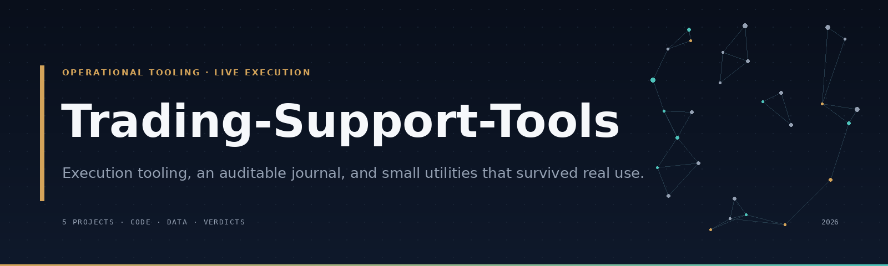

# Trading-Support-Tools

*Execution tooling, an auditable journal, and small utilities that survived real use.*

This repository is the operational side of [`Financial-Market-Theories`](https://github.com/edouwarden/Financial-Market-Theories). It is not a signal repository. It contains the system I built to execute and record trades, the export that came out of it, and a small set of tools that are useful beyond that system.

The main project is **betterGTrade**. Section 01 is the full write-up, and [`journal/`](journal/) holds its data and analysis. The other sections are shorter because the tools are smaller.

The approach it executes is deliberate asymmetry: low margin, high leverage, and a precise entry, with 10R to 50R targets on setups that work roughly 30% of the time. Section 01 explains how that is managed and what the export shows.

Each project below opens with its **Context** — the problem it exists to solve — then the **Solution** and its **Status**. betterGTrade also explains its strategy and reports the execution result. To skim, read Context, Strategy, and Status.

**Status:** 🟢 shipped and used · 🟠 usable with limits · 🔴 kept as a record.

---

## Index

1. **[betterGTrade](#01)**<br>
    *A live perpetual-futures execution bot, its order lifecycle, and the execution record.*
2. **[Journal](#02)**<br>
    *The 1,059-row export and the dependency-free script that turns it into metrics.*
3. **[Week calendar](#03)**<br>
    *A macro calendar that normalises to UTC and exports text, JSON, CSV, and ICS.*
4. **[Disclosure flow](#04)**<br>
    *Insider and politician disclosure feeds, normalised into compact reports.*
5. **[Chart overlays](#05)**<br>
    *Two chart helpers — a day divider and a session-open fill — isolated from a third-party Pine composite.*
6. **[Theories used as tools](#06)**<br>
    *The research ideas that became operational context, and the ones that did not.*

---


## 01

**Data:** [`journal/`](journal/)

### Context

A discretionary trader running many small perpetual-futures orders needs three things that a manual workflow cannot reliably give: consistent position management, risk state that survives a restart, and a record that can be inspected after the fact. The hard part is not opening an order. It is keeping the lifecycle coherent when the process dies, the API returns a partial fill, or a trailing stop has to be reconstructed from disk.

### Solution

betterGTrade is a live execution system built and operated on Gains Network. It watched a configured market list, sized and placed orders through the Gains Network API, managed leverage, stop loss, take profit, and optional trailing stops, kept a local journal of orders, fills, notes, and chart screenshots, posted lifecycle updates to Discord, and reloaded open positions and trailing-stop state after a restart. The list included the degen pairs BTCDEGEN and SOLDEGEN, which allow up to 500x and priority execution; the label describes the execution terms, not the underlying asset, and the pair was used for snipe entries.

The private source covers the API client, WebSocket feed, transaction manager, position monitor, state store, and Discord UI. It is not published because it contains wallet and RPC configuration. The operational surface is the interesting part:

- **Order lifecycle.** Orders are not trades. The export repeats each trade across several rows and includes orders that were never realised: 98 trade IDs, 49 with a non-zero result.
- **Crash recovery.** Open positions and trailing-stop state must survive a restart, or the bot silently loses its risk configuration.
- **Reconciliation.** Local journal fields are not an exchange statement. Fees, funding, borrowing, and position-size conventions have to be decoded before any P&L number is meaningful.
- **Failure handling.** API errors, partial fills, and WebSocket gaps have to fail closed rather than leave an unmanaged position.

### Discord surface

There was no separate dashboard. Each position became a Discord message, and the message was the control panel: the embed held the live state, the buttons called the API, and the modals carried the values. Embeds edited in place as price, tracking, and journal content changed.

The images are rebuilt from the bot's UI modules and populated with journal rows. They show the embed and its components only — no sidebar, channel header, member list, or message box.

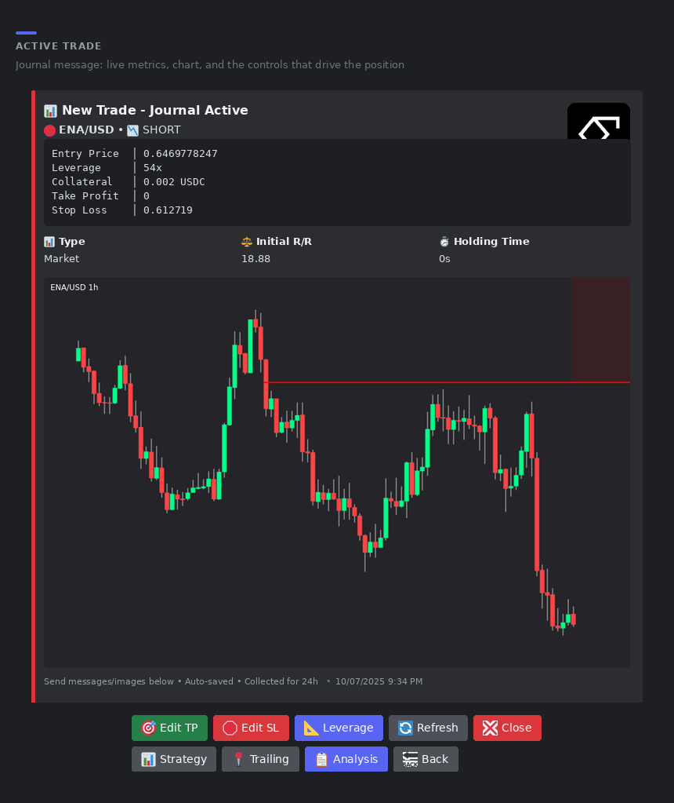

*Trade 237, ENA/USD short. The message edits itself while the position is open; the buttons are the only interface to TP, SL, leverage, close, analysis, and tracking.*

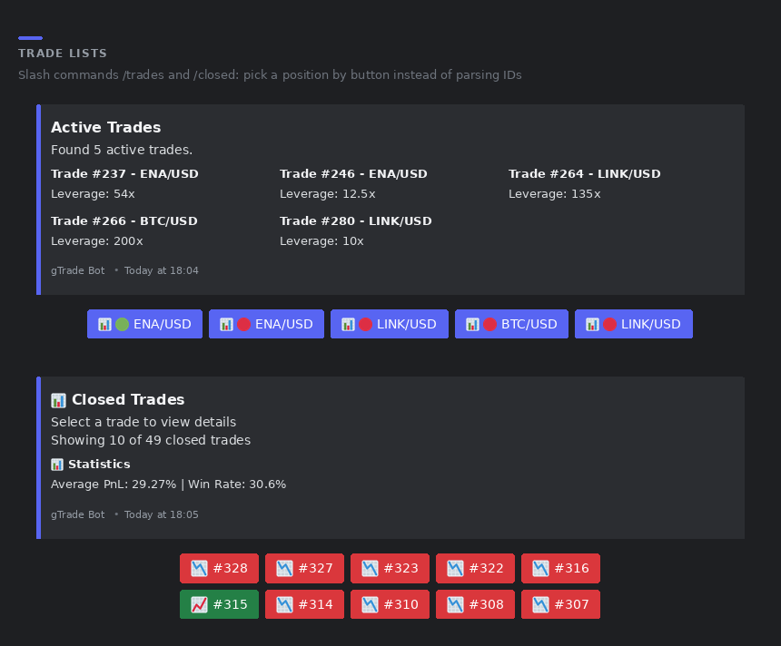

*`/trades` and `/closed`. The closed list carries average PnL and win rate, and wraps its buttons five per row so the message stays readable.*

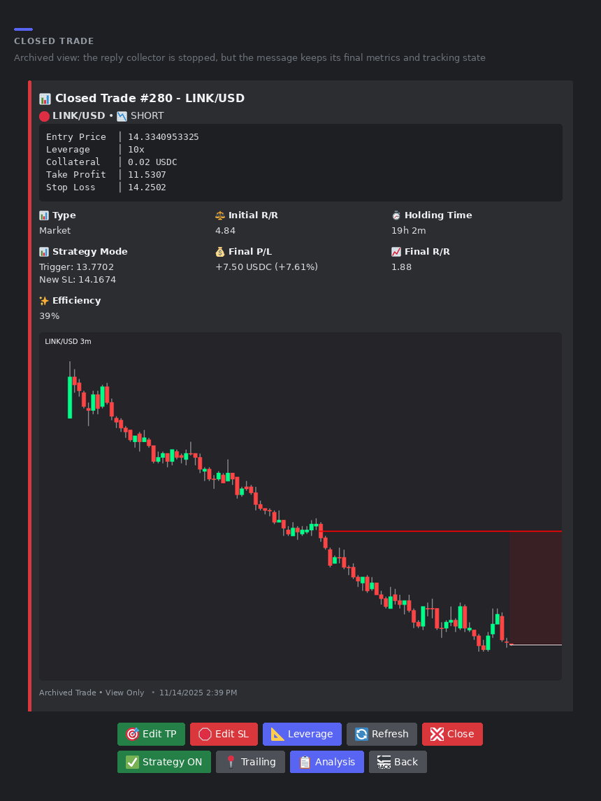

*Trade 280, LINK/USD short. Final P/L, final R/R, and efficiency are added on close, next to the strategy configuration that was active. R/R and efficiency are normalised to implied USD margin because the export stores collateral in token units.*

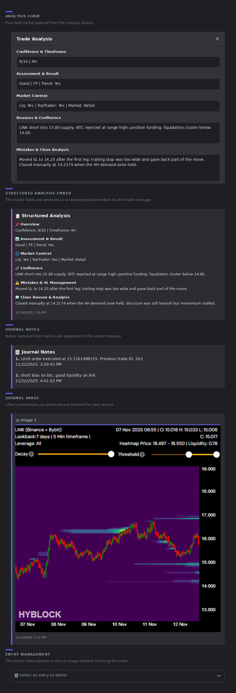

*The five-field analysis modal, its structured embed, notes captured from replies, and the image index. Analysis was reconstructed from the modal fields.*

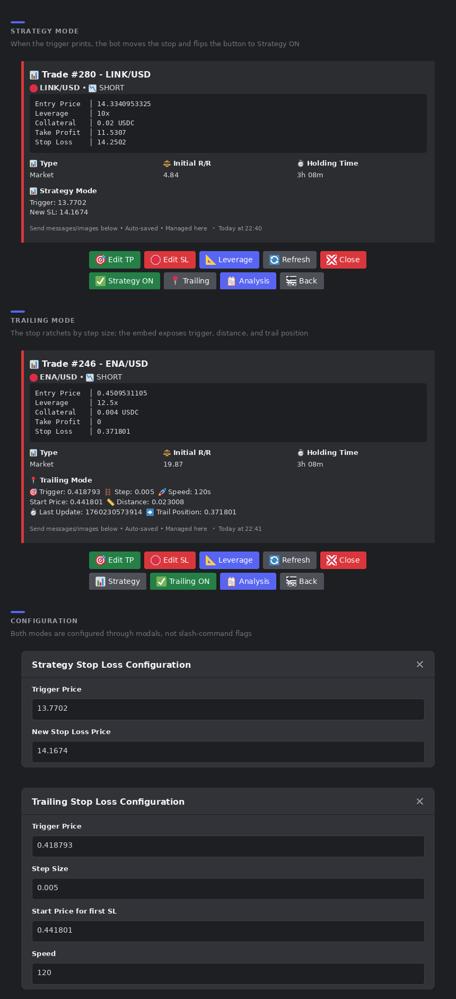

*Strategy mode moves the stop once a trigger prints; trailing mode ratchets it by a step. The button shows which mode is armed.*

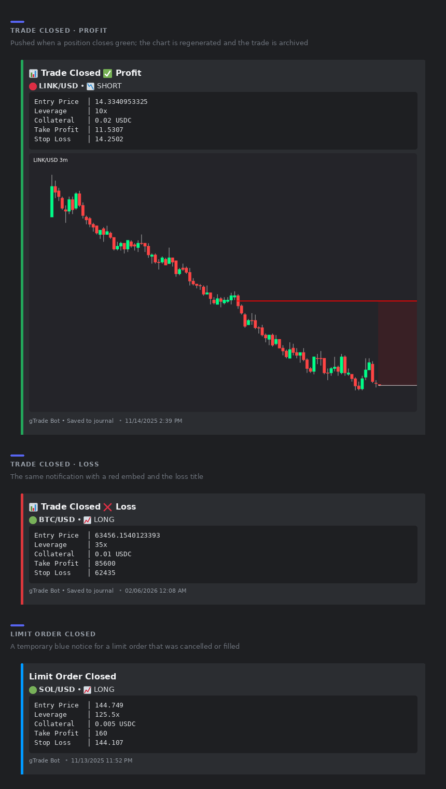

*Close notifications: green for profit, red for loss, blue for a limit order that was cancelled or filled.*

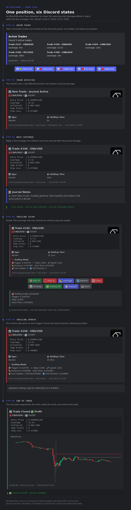

*The same message across six states: entry point → detection → note → trailing setup → monitor alert → close. Prices and tracking values come from trade 246; the note text is illustrative. The trailing stop is bot-managed because Gains Network has no native trailing order.*

### Strategy

The strategy is deliberate asymmetry, not a high hit rate. Positions use **low margin at high leverage** and are opened only on a precise level — typically an order block or a liquidity sweep — with a stop that invalidates the idea immediately. Because the entry is tight, a failed setup costs little and the margin at risk stays low even at high leverage.

The target is **10R to 50R**, where R is the amount risked on the entry. That shape implies a low hit rate: the setup is expected to work roughly **30% of the time**. The book is carried by the minority of entries that reach the far target, while the majority close as small, controlled losses. Win rate on its own therefore says little about the strategy; the ratio of average win to average loss is the number that matters.

### Result

Operated from **2025-10-07 to 2026-02-05**. The export contains 1,059 rows across 98 trade IDs, 731 with a close time, and 49 with a non-zero realised profit. It is the bot's own journal, not an exchange statement; fills, fees, funding, and position-size conventions have not been reconciled.

| Metric | Value |
|---|---|
| Rows | 1,059 |
| Trade IDs | 98 |
| Closed rows | 731 |
| Realised trades (`profit ≠ 0`) | 49 |
| Wins / losses | 15 / 34 |
| Win rate | 30.6% |
| Journal net `profit` | +1,437.21 |
| Average win / average loss | +209.49 / −50.15 |
| Worst trade | −109.75 |
| Profit factor | 1.84 |
| Median hold | 39.7 min |

*The 30.6% win rate is the expected output of a 10R–50R target, not a defect: the average win is 4.2× the average loss.*

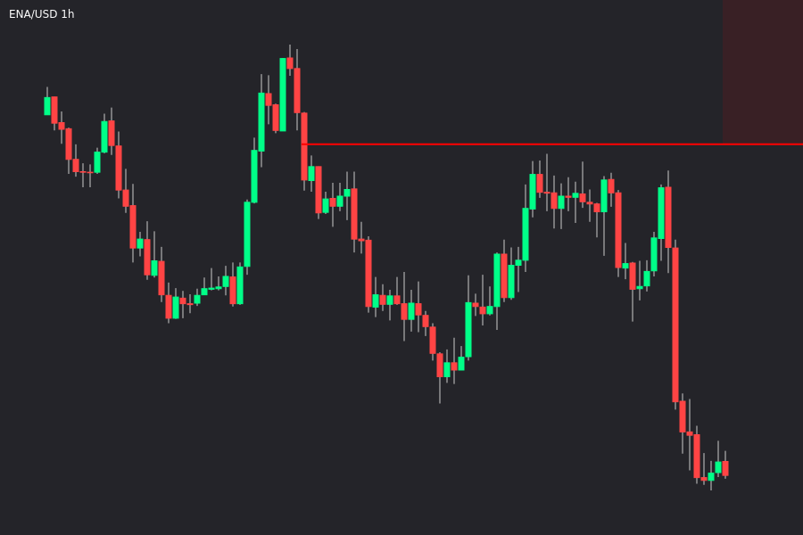

*Trade 237, ENA/USD short at 54x. Entry 0.64698 → exit 0.40944, recorded as **+1,979.34** over a 3-day hold. Journal chart, 1h.*

### Status

🟢 Shipped and operated. The engineering is real and the failure modes are documented. The journal is unreconciled: treat the aggregate as a description of the export, not an audited track record.

### Next

1. Reconcile every `tradeId` against exchange or on-chain fills before reporting any aggregate.
2. Rebuild PnL from open/close, size, direction, fees, funding, and borrowing.
3. Separate cancelled orders from executed trades at the source, not in analysis.
4. Log the risk configuration with each fill so post-mortems do not depend on reconstructing state.
5. Curate a small set of screenshots matched to trade IDs rather than publishing 124 loosely named files.

### Field note

> “The interesting part was not the entry. It was keeping the position, its stop, and its journal consistent across restarts, partial fills, and a UI that had to stay in sync.”

That is the problem this section documents.

---


## 02

**Folder:** [`journal/`](journal/)

### Context

An execution bot produces far more order events than completed trades. Without a separate, runnable analysis layer, the export turns into a folder of screenshots and the numbers are whatever the UI last displayed. The journal has to stand on its own.

### Solution

The export is a single JSON file of 1,059 rows across 98 trade IDs, and most of those rows repeat the same trade. Only 49 trade IDs carry a non-zero `profit`; `pnl` is zero everywhere and is not used. The analysis script reads the export directly, computes win rate, profit factor, holding time, and breakdowns by day and pair, and writes `results/metrics.json`.

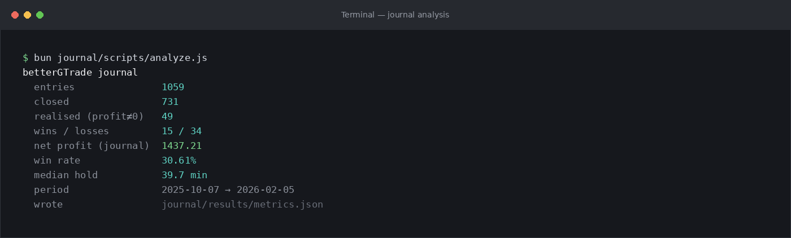

*Actual `analyze.js` output, with the output path shortened for display.*

```bash
cd journal
bun scripts/analyze.js      # or: node scripts/analyze.js
```

The script is plain ESM with no dependencies. It reproduces the same numbers as section 01. After collapsing repeated export rows, the export contains **87 unique notes** and **44 unique image references** across **98 trade IDs**.

The note review and publication gate is `python3 scripts/review_notes.py` (audit → check → build). The raw export and review files stay local; the published subset is `journal/data/public/journal-highlights.json`, with 18 reviewed notes and 16 chart captions in English.

### Status

🟢 Runnable and dependency-free. It reports 15 wins, 34 losses, a 30.6% win rate, a +1,437.21 net, and a 39.7-minute median hold. That is a description of the export, not audited P&L. Screenshots stay gitignored until each is checked and matched to a `tradeId`.

### Field note

The raw export is not committed. Local filesystem paths and Discord CDN attachment URLs were stripped before analysis; neither is used by the aggregate. Notes are not published as written: they were translated into English and reduced to a reviewed subset, with the French originals kept local.

---


## 03

**Folder:** [`week-calendar/`](week-calendar/)

### Context

A macro calendar is a data-normalisation problem, not a delivery integration. Releases arrive in a source timezone, and a careless conversion files an 08:30 ET print on the wrong UTC day. The useful output is a canonical instant plus the source-local date, in a format another tool can consume.

### Solution

The tool fetches the Fair Economy weekly feed, validates every timestamp, and keeps three representations per event: the original string, the canonical UTC instant, and the source-local calendar date. Grouping uses the local date, so an 08:30 ET release stays on Tuesday even though it is 13:30 UTC. The CLI filters by date and impact and exports text, JSON, CSV, or RFC 5545 ICS.

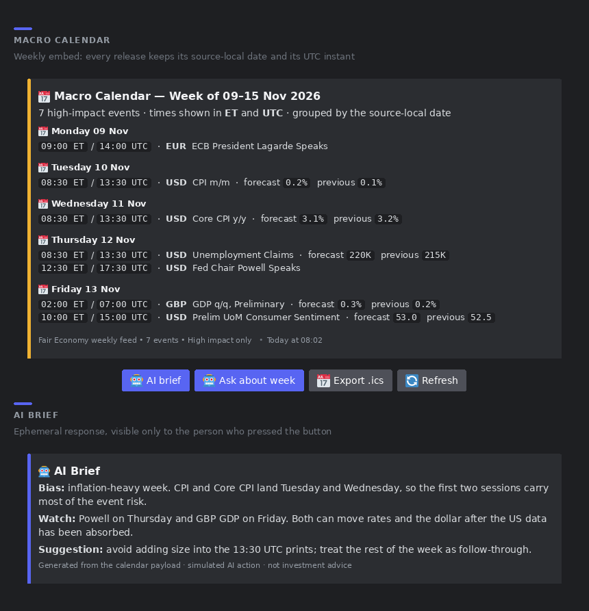

*Embed-only Discord mockup using the `--sample` week; no client chrome. AI actions are simulated and the published CLI is offline.*

```bash
bun week-calendar/src/index.js --sample
bun week-calendar/test/run.js
```

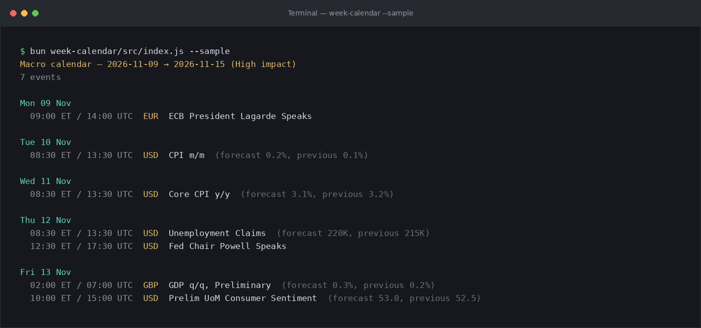

*Actual `--sample` output.*

The sample is a fixed week of synthetic events in `data/sample/`. The test runner covers date validation, the Monday–Sunday range, UTC conversion, impact filtering, grouping order, CSV escaping, and ICS output.

### Status

🟢 Shipped and used. **13 tests pass** with no dependencies. The offline demo renders a grouped text view, JSON with metadata, a CSV with UTC and source-local times, and an ICS file with UTC `DTSTART` values. No key, no webhook, no hardcoded Discord data. Limits: the feed covers this week only, there is no `actual` field, and aggressive clients are rate-limited.

---


## 04

**Folder:** [`disclosure-flow/`](disclosure-flow/)

### Context

Disclosure feeds are noisy, late, and formatted for humans. The risk is treating a filing as a live signal. The useful output is a compact view of what was disclosed, how stale it is, and which tickers attracted more than one participant.

### Solution

Two trackers share one CLI. The insider tracker keeps the latest filing day, sorts by reported USD value, returns the top ten, and totals buys and sells. The politician tracker groups trades by ticker, politician, and party; flags tickers where at least two politicians traded and one side dominates; and reports the disclosure lag. Dollar amounts use the **lower bound** of each disclosed range.

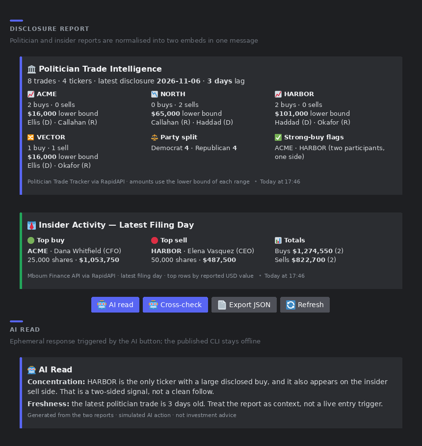

*Embed-only Discord mockup using the `--demo` fixtures; no client chrome. AI actions are simulated and the published CLI is offline.*

```bash
bun disclosure-flow/src/index.js --demo
```

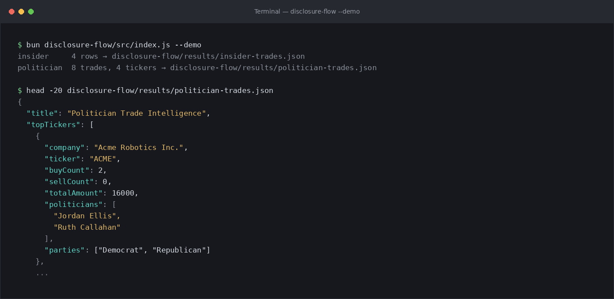

*Actual `--demo` output and the first record of the generated report.*

The demo reads synthetic fixtures in `data/sample/` and exercises the same parsing and aggregation code as the live feeds. Live modes need `RAPIDAPI_KEY`.

### Status

🟠 Usable with limits. The demo produces **4 insider rows** and **8 politician trades across 4 tickers**, with party breakdown and `daysSinceLatestTrade`. No vendor data is redistributed. Disclosure lag, range-based amounts, missing position context, and vendor labels are passed through rather than guessed. There is no forward-return test.

---

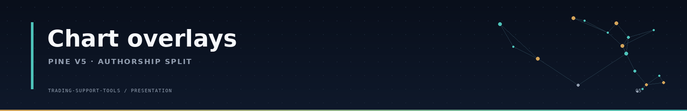

## 05

**Evidence:** one chart screenshot · **Source:** private

### Context

A chart overlay is easy to over-claim. The indicator I ran was a composite: a third-party base plus two small helpers I wrote. The honest unit of evidence is the screenshot, not the merged source.

### Solution

The two helpers are a vertical divider at each day boundary and a fill between that day's first price and the current price. Green marks price above the reference, pink below. They make intraday context readable without adding a signal.

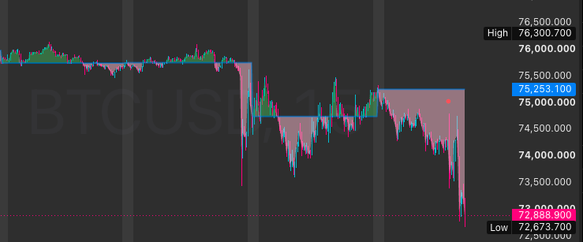

*BTCUSDT intraday: day dividers and the session-open fill. Green = above the day's first price; pink = below. The rest of the chart belongs to the third-party base.*

The reference is captured when `hour == 0 and minute == 0`, so the historical “2 AM” label is wrong. Everything else in the composite — the news/calendar base, forecast boxes, time-range boxes, opening-range box, and period boxes — is not claimed. The source stays private because it depends on a third-party base and private TradingView imports.

### Status

🟠 Screenshot only. Two small presentation helpers, isolated from a third-party composite. Nothing here produces a signal or an edge.

---


## 06

**Folder:** [`Financial-Market-Theories/theories/`](https://github.com/edouwarden/Financial-Market-Theories/tree/main/theories)

### Context

The research repository produced 18 tested ideas. Only some became part of the working loop; the rest are records, including the failures. A positive result is not automatically a tool.

### Solution

Each entry below is used as confirmation or context, never as a standalone signal. The table maps the working set to the theory that carries the full write-up.

| # | Theory | Tool | How it is used | Status |
|---|---|---|---|---|
| 02 | [Price momentum vs OI momentum](https://github.com/edouwarden/Financial-Market-Theories#02) | Pine four-quadrant scripts | Reads whether a move is leveraged and crowded, or spot-driven | 🟢 Workflow tool |
| 03 | [Liquidation levels](https://github.com/edouwarden/Financial-Market-Theories#03) | `liquidation-levels.pine` | Adds entry precision to the momentum read | 🟢 Works next to 02 |
| 08 | [Leaderboard positioning](https://github.com/edouwarden/Financial-Market-Theories#08) | `toptrader.js` | Average leverage as a confirmation input; private identifiers stay local | 🟢 Confirmation |
| 16 | [Attention index](https://github.com/edouwarden/Financial-Market-Theories#16) | News and Twitter collectors | Retail attention as a confirmation indicator | 🟢 Confirmation |
| 17 | [Indicator crowding](https://github.com/edouwarden/Financial-Market-Theories#17) | TradingView collectors | Crowding dashboard, not a timing signal | 🟢 Confirmation |
| 10 | [Order-book walls](https://github.com/edouwarden/Financial-Market-Theories#10) | Python depth and report scripts | Pre-trade context on displayed liquidity | 🟠 Context only |
| 12 | [Supply events](https://github.com/edouwarden/Financial-Market-Theories#12) | `supply-events.js` | Unlock and airdrop alert, not a trade signal | 🟠 Alert only |

The tools were exercised in live use: the Pine reads on chart, the leaderboard panel on a synthetic fixture, the attention and crowding collectors on their samples, the order-book report on a snapshot, and the supply script on event records. None of them has a forward-return test in this repository.

### Status

🟢 Five confirmation or workflow tools. 🟠 Two context tools. Theories 01 and 18 are not in this list: surebet capacity is a research result with a manual calculator, and weather mood did not survive as usable context.

The [theories index](https://github.com/edouwarden/Financial-Market-Theories#index) carries every write-up, including the ones that failed.

---

## Data and reproducibility

- **Sample data** is committed under each tool's `data/sample/` so a reader can run it without keys.
- **Journal export** stays local at `journal/data/trade_journal.json` and is gitignored, as are raw screenshots under `journal/evidence/raw/`. The committed journal material is the aggregate in `journal/results/metrics.json` plus a reviewed subset; `journal/scripts/review_notes.py` gates it.
- **Screenshots** are generated from recorded data and tool output. Discord images are embed-only reconstructions or mockups — no client chrome — and are labelled as such. Real captures are staged locally in `assets/screenshots/incoming/`, which is gitignored; only cropped, checked images are promoted to `assets/screenshots/`.
- **Private source** is gitignored under `betterGTrade/private-src/`.
- **No proprietary redistribution.** Vendor feeds and exchange data are not committed; only derived metrics and small synthetic samples are.
- Every tool that ships sample data has a no-network mode: `--sample` for the calendar and `--demo` for disclosure flow. The analysis script reads the local journal export; `journal/results/metrics.json` is its last output, committed so the numbers can be read without the export.

## Security

No API keys, private keys, wallet addresses, tokens, or webhook URLs are committed. Tools read credentials from environment variables and fail clearly when a value is missing.

## Disclaimer

Research and educational material only. Not financial advice. Trading involves risk, including total loss.
